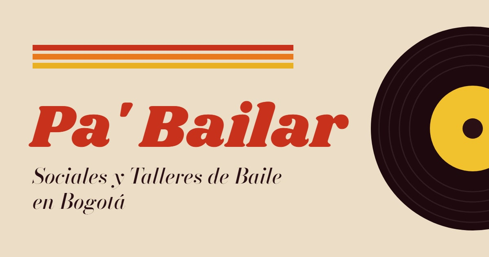

  

<b>Sociales y talleres de baile en Bogotá, en un solo lugar.</b> 
<a href="https://pa-bailar.github.io">pa-bailar.github.io</a>

---

**Pa' Bailar** es una agenda gratuita de lo que pasa en la escena de baile de Bogotá: sociales, talleres, conciertos,
festivales y congresos de salsa, bachata, kizomba, tango, urbano y más. Sin registro y sin anuncios; se puede instalar
en el teléfono como una app.

### Cómo funciona

1. **Dos veces al día** se revisan las publicaciones de Instagram de más de 120 academias, organizadores, profes y
   salsotecas de la ciudad.
2. **Un modelo de IA** reconoce los eventos en los flyers y los textos: la fecha, la hora, el lugar, el precio y los
   ritmos. Las reglas del código revisan lo que lee antes de publicarlo.
3. **El sitio se actualiza solo**, con filtros por fecha, ritmo y tipo, un calendario y una lista de guardados.

### Repositorios

- [`pa-bailar.github.io`](https://github.com/pa-bailar/pa-bailar.github.io): el sitio (Astro y TypeScript).
- [`backend`](https://github.com/pa-bailar/backend): el barrido (Python, la API de Instagram y Gemini) y las
  herramientas de administración.
- [`media`](https://github.com/pa-bailar/media): los flyers y videos que muestra el sitio.

---

<b>In English:</b> Pa' Bailar is a free agenda of dance events in Bogotá (socials, workshops, concerts and
festivals of salsa, bachata and more). Twice a day it reads the Instagram posts of 120+ local academies, organizers
and salsa bars, an AI model picks out each event's date, time, place and price, and the site updates itself.
